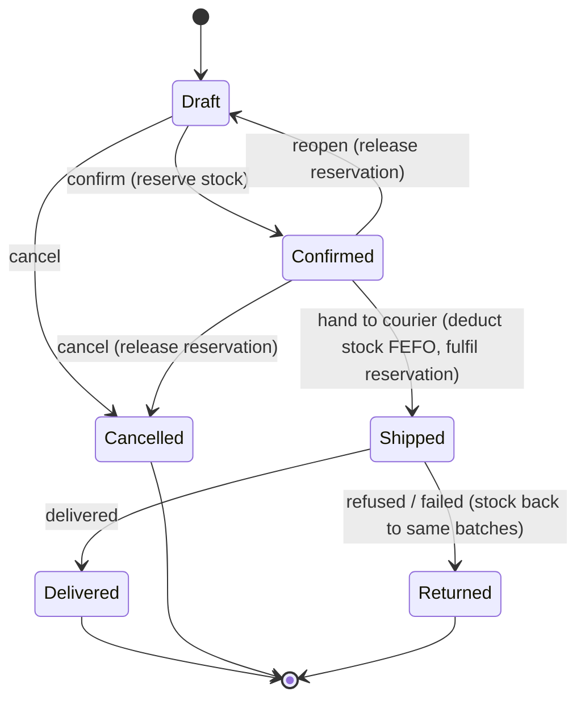

# ÀLara Line ERP — Architecture & Database Design (Phase A)

Status: **implemented** (MVP, 2026-10-15). Differences from the original proposal are listed in §11.

## 1. Environment findings (verified 2026-10-15)

| Item | Finding |
|---|---|
| Repository | `backend/` only; `AlaraERP.Api` is the unmodified `webapi` template (WeatherForecast). Not a git repo. |
| .NET | SDK 10.0.300. `Microsoft.AspNetCore.OpenApi` 10.0.8, `Microsoft.OpenApi` 2.7.5 (patched) — keep as is. |
| Node / npm | v26.0.0 / 11.12.1 |
| PostgreSQL | 17.11 (Homebrew service, running). Database `alara_erp` **exists and is empty** (only `public`, no tables). Owned by `razanhasbini` (superuser). |
| Docker | Installed, daemon not running → integration tests use a separate local database `alara_erp_test`. |
| EF tooling | `dotnet-ef` not installed → will be added as a **local** tool (`.config/dotnet-tools.json`), not global. |

## 2. Solution structure

Layered projects (layer boundaries enforced by the compiler through project references), module folders inside each layer (module boundaries enforced by architecture tests).

```text
alara-erp/
├── backend/
│   ├── AlaraERP.slnx
│   ├── src/
│   │   ├── AlaraERP.Domain/            # entities, invariants, enums — no dependencies
│   │   │   ├── Common/                 # Entity base, DomainException, Money helpers
│   │   │   ├── Identity/  Catalog/  Inventory/  Sales/
│   │   ├── AlaraERP.Application/       # use-case services, DTOs, validators, interfaces
│   │   │   ├── Common/                 # paging, Result/errors, ICurrentUser, IClock
│   │   │   ├── Identity/  Catalog/  Inventory/  Sales/  Dashboard/
│   │   ├── AlaraERP.Infrastructure/    # EF Core DbContext, configurations, migrations,
│   │   │   ├── Persistence/            #   Identity setup, file storage, seeding
│   │   │   ├── Identity/  Storage/  Seeding/
│   │   └── AlaraERP.Api/               # existing project: controllers, auth, ProblemDetails
│   └── tests/
│       ├── AlaraERP.UnitTests/         # domain rules, validators, totals
│       ├── AlaraERP.IntegrationTests/  # real PostgreSQL (alara_erp_test) via WebApplicationFactory
│       └── AlaraERP.ArchitectureTests/ # layer + module dependency rules
├── frontend/                           # React + TS + Vite
└── docs/
```

Project references: `Api → Application, Infrastructure` · `Infrastructure → Application, Domain` · `Application → Domain` · `Domain → nothing`.

**Why not one project per module?** Five modules × four layers is 20 projects for a small team — slow builds and ceremony with no benefit at this size. The cost of the chosen approach is that module boundaries are a convention, so they are enforced by tests:

- `Sales` may call `Inventory` and `Catalog` only through their public application interfaces (e.g. `IStockReservationService`, `ICatalogLookup`), never their internal services or DbSets directly.
- `Catalog` does not depend on `Inventory` or `Sales`. `Inventory` may read `Catalog` via `ICatalogLookup`.
- `Dashboard` is read-only and may query across modules (it is a reporting module by definition).

**Single DbContext.** `AlaraDbContext : IdentityDbContext<AppUser, AppRole, Guid>` spans all schemas. Order confirmation (sales) and stock reservation (inventory) must commit atomically; one context gives one transaction without distributed-transaction tricks. Each module owns its entity configurations under its own folder and schema.

**No** MediatR/CQRS, no generic repository — application services use the DbContext directly (via an `IAlaraDbContext` interface exposing module DbSets).

## 3. Cross-cutting design

| Concern | Decision |
|---|---|
| Auth | ASP.NET Core Identity + **cookie** auth (HttpOnly, Secure, `SameSite=Strict`, 8h sliding, no persistent "remember me" by default). No JWT, nothing in localStorage. |
| CSRF | ASP.NET antiforgery: token issued at `/api/auth/csrf`, sent back in `X-XSRF-TOKEN` header on every unsafe request; validated globally. |
| Origin / CORS | Dev: Vite proxies `/api` → backend, so browser sees one origin; CORS disabled. Prod: serve SPA from same host or explicit single-origin CORS. |
| Brute force | Identity lockout (5 failures → 15 min) + ASP.NET rate limiter on `/api/auth/login` (per-IP fixed window). Generic "invalid credentials" message. |
| Deactivation | `is_active=false` → login refused; existing sessions killed via security-stamp update + `OnValidatePrincipal` check (≤1 min). |
| Permissions | Stored as role claims (`permission` = `products.view` …). Dynamic policy provider: `[HasPermission(Permissions.Products.Create)]`. |
| Role escalation | Only Super Admin can grant Super Admin; a user can only assign roles whose permissions ⊆ their own; cannot deactivate self; last active Super Admin cannot be removed/deactivated. |
| Admin bootstrap | `dotnet run -- bootstrap-admin` reads email/password from user-secrets / env vars, creates the first Super Admin only if none exists. No committed credentials. |
| Errors | Global exception handler → RFC 7807 ProblemDetails; validation → 400 with field errors; business-rule violations → 409/422; no stack traces outside Development. |
| Validation | FluentValidation for request DTOs + DB constraints as last line of defence. |
| Logging | Built-in `ILogger` with structured messages (JSON console in Production). Serilog not needed for MVP. |
| Time | `TIMESTAMPTZ`, UTC everywhere, `TimeProvider` injected for testability. |
| Money | `decimal` / `NUMERIC(12,2)`; unit cost `NUMERIC(12,4)`. **Base currency USD** (config `Erp:BaseCurrency`), stored on each order as a snapshot. |
| Concurrency | Stock rows locked with `SELECT … FOR UPDATE` inside a transaction, locked in a deterministic order (warehouse_id, product_id) to avoid deadlocks; CHECK constraints prevent negative stock even if code is wrong. Orders use PostgreSQL `xmin` as an optimistic concurrency token. |
| Images | `IFileStorage` abstraction; local disk (`App_Data/uploads`, outside wwwroot root path control) in dev; DB stores a generated storage key, never a user path. JPEG/PNG/WebP, ≤ 5 MB, content sniffed. |
| DB access | App connects as non-superuser `alara_app` (DML only). Migrations run as `alara_owner` (owns schemas). See §8. |

## 4. Modules

### 4.1 Identity — schema `identity`
Standard ASP.NET Identity tables renamed to snake_case: `users, roles, user_roles, user_claims, role_claims, user_logins, user_tokens`.
`users` adds: `first_name, last_name, is_active, created_at, updated_at, last_login_at` (email, phone, lockout, password hash etc. already provided by Identity).
`roles` adds: `description, is_system` (system roles cannot be deleted).

**Permissions**

| Permission | Super Admin | Manager | Inventory Mgr | Sales | Viewer |
|---|:-:|:-:|:-:|:-:|:-:|
| products.view | ✓ | ✓ | ✓ | ✓ | ✓ |
| products.create / update / delete | ✓ | ✓ | | | |
| products.manage_pricing | ✓ | ✓ | | | |
| inventory.view | ✓ | ✓ | ✓ | ✓ | ✓ |
| inventory.receive / adjust / transfer | ✓ | ✓ | ✓ | | |
| inventory.manage_thresholds | ✓ | ✓ | | | |
| warehouses.manage | ✓ | ✓ | | | |
| orders.view | ✓ | ✓ | | ✓ | ✓ |
| orders.create / update | ✓ | ✓ | | ✓ | |
| orders.cancel | ✓ | ✓ | | ✓ | |
| orders.manage_payments (cash collection / remittance) | ✓ | ✓ | | | |
| delivery_companies.manage | ✓ | ✓ | | | |
| reports.view | ✓ | ✓ | | | ✓ |
| users.view | ✓ | ✓ | | | |
| users.create / update / assign_roles | ✓ | | | | |

Low-stock thresholds are set per product by a Manager (`inventory.manage_thresholds`), as agreed.

### 4.2 Catalog — schema `catalog`
- **categories** — hierarchy via `parent_category_id`; self-parenting blocked by CHECK, cycles blocked in the service.
- **products** — one sellable version per row (scents are separate products; scented bundles are separate bundle SKUs). Includes website-ready fields (slug, short description, how-to-use, ingredients, size, weight, compare-at price) so the future React site can read from the ERP. **No stock quantity here.**
- **bundle_items** — components of a bundle; components must be `Individual` (no nested bundles); no self-reference; quantity > 0; unique per (bundle, component).
- **product_images** — storage key + order + `is_primary` (partial unique index: one primary per product).

Products referenced by orders are never hard-deleted: delete = deactivate if referenced (`products.delete` hard-deletes only never-used products).
Bundle availability = min over components of ⌊available(component) / qty⌋, per warehouse.

### 4.3 Inventory — schema `inventory` (with batch & expiry tracking)

**Model**: stock exists in **batches**. Every receipt line goes into a batch (existing or new). Products that don't expire (brushes, towels) still get a batch with `expiry_date = NULL`, so there is one uniform model.

- **product_settings** (1:1 with product, owned by Inventory): `low_stock_threshold`, `tracks_expiry`. Keeps inventory policy out of the catalog table.
- **batches**: `product_id, batch_number, expiry_date`; unique (product_id, batch_number).
- **stock_balances** (warehouse, product): `quantity_on_hand, quantity_reserved` — the fast aggregate used for availability and reservation locking.
- **batch_balances** (warehouse, batch): `quantity_on_hand` — where the units physically are.
  Invariant (enforced in the same transaction, covered by tests): Σ batch_balances.on_hand = stock_balances.on_hand per (warehouse, product).
- **stock_reservations**: per order × product × warehouse; status `Active → Fulfilled | Released`. Reservations are at product level, not batch level — batches are picked at shipment.
- **stock_movements**: immutable ledger, every change of on-hand creates a row with `batch_id`, signed `quantity_change`, type, reference (receipt / transfer / order / adjustment), user, reason.
- **stock_receipts / stock_receipt_lines**: supplier name + reference (free text until the Purchasing module exists), `unit_cost` per line (optional).
- **stock_transfers / stock_transfer_lines**: completed atomically in the MVP (no in-transit state); each line records the batch moved; writes Transfer Out + Transfer In movements.

**Batch picking & expiry rules**
- Shipment and transfers pick batches **FEFO** (first-expiry-first-out; non-expiring batches last).
- **Expired batches are never shipped.** If non-expired stock is insufficient, shipping fails with a clear error; the expired units must be written off via an Adjustment (reason "Expired").
- Dashboard + inventory list show **expired** and **expiring within N days** (config `Inventory:ExpiryWarningDays`, default 60).
- Reservations count all on-hand stock (including soon-to-expire); expired stock should be written off promptly — the dashboard flags it.

Movement types: `Receipt, Shipment, Return, AdjustmentIncrease, AdjustmentDecrease, TransferOut, TransferIn`.
Adjustment reasons: `Damaged, Expired, CountCorrection, Lost, Sample/Gift, Other` (+ mandatory notes for Other).

### 4.4 Sales — schema `sales`
- **orders** — status, payment status, source, warehouse, totals (snapshots), recipient snapshot (name, phone, city, address — indexed phone so a future Customers module can backfill `customer_id`), delivery company, tracking number, delivery fee charged, courier fee, timestamps per milestone.
- **order_items** — product/bundle snapshot (name, SKU, type, unit price, discount, line total).
- **order_item_components** — bundle composition snapshot at order time (component id, name, SKU, qty per bundle, total qty). Reservations and shipment use this snapshot, so later bundle edits never affect existing orders.
- **order_history** — status and payment changes (old → new, who, when, notes). Generalises the proposed `order_status_history` so payment changes are audited in the same place.
- **delivery_companies** — name, phone, active.
- **courier_remittances** — a cash hand-over from a delivery company (amount, date, who recorded it), linked to the orders it settles.

**Order lifecycle**



- Items are editable only in **Draft**. To change a confirmed order, reopen it (releases stock) or cancel.
- Stock is deducted exactly once, at **Shipped**; Delivered and Returned never deduct. Cancel releases only Active reservations; Returned restores only what was shipped (from the movement records). Each transition is idempotent-guarded by the state machine + reservation status.
- Delivered → Returned is **not** allowed in the MVP (no returns policy yet).

**Payment** (separate from fulfilment)
- `payment_method`: `CashOnDelivery` (default) — enum is ready for `Whish, OMT, BankTransfer, Cash` once confirmed.
- `payment_status`: `Unpaid → CollectedByCourier → Paid` for COD (Delivered sets CollectedByCourier; a remittance sets Paid). Non-COD methods: `Unpaid → Paid`. Cancelled/Returned orders → `Void`.
- Delivery fee default: config `Sales:DefaultDeliveryFee` = 4.00 USD, editable per order (e.g. free delivery).

Order numbers: PostgreSQL sequence → `AL-000001`.

### 4.5 Dashboard
Read-only aggregation endpoints. Metric definitions:
- **Collected revenue** = Σ grand_total of orders with `payment_status = Paid`.
- **Delivered, awaiting cash** = Σ grand_total of Delivered orders with `CollectedByCourier` (owed by couriers).
- **Open order value** = Confirmed + Shipped.
- Cancelled/Returned/Draft are never counted as revenue.
- Inventory: total units on hand, by warehouse, low-stock products (available ≤ threshold), expired / expiring batches.

## 5. ERD

```mermaid
erDiagram
    %% ---------- identity ----------
    users {
        uuid id PK
        varchar email "Identity fields: user_name, normalized_*, password_hash, security_stamp, lockout_*, access_failed_count ..."
        varchar first_name
        varchar last_name
        boolean is_active
        timestamptz created_at
        timestamptz updated_at
        timestamptz last_login_at
    }
    roles {
        uuid id PK
        varchar name
        text description
        boolean is_system
    }
    user_roles { uuid user_id PK,FK
                 uuid role_id PK,FK }
    role_claims { int id PK
                  uuid role_id FK
                  varchar claim_type "permission"
                  varchar claim_value "e.g. orders.create" }
    user_claims { int id PK
                  uuid user_id FK }
    user_logins { varchar login_provider PK
                  varchar provider_key PK
                  uuid user_id FK }
    user_tokens { uuid user_id PK,FK
                  varchar login_provider PK
                  varchar name PK }
    users ||--o{ user_roles : has
    roles ||--o{ user_roles : has
    roles ||--o{ role_claims : grants
    users ||--o{ user_claims : has
    users ||--o{ user_logins : has
    users ||--o{ user_tokens : has

    %% ---------- catalog ----------
    categories {
        uuid id PK
        varchar name "unique among siblings"
        varchar slug UK
        text description
        uuid parent_category_id FK "nullable, != id"
        int sort_order
        boolean is_active
        timestamptz created_at
        timestamptz updated_at
    }
    products {
        uuid id PK
        uuid category_id FK "nullable"
        varchar name
        varchar slug UK
        varchar sku UK
        varchar barcode UK "nullable"
        varchar product_type "Individual | Bundle"
        text short_description
        text description
        text how_to_use
        text ingredients
        numeric size_value "nullable, > 0"
        varchar size_unit "ml | g | pcs"
        int weight_grams "nullable, >= 0"
        numeric selling_price "12,2 >= 0"
        numeric compare_at_price "12,2 nullable, >= selling_price"
        boolean is_active
        timestamptz created_at
        timestamptz updated_at
    }
    bundle_items {
        uuid id PK
        uuid bundle_product_id FK
        uuid component_product_id FK "!= bundle, Individual only"
        int quantity "> 0"
    }
    product_images {
        uuid id PK
        uuid product_id FK
        text storage_key
        varchar content_type
        int display_order
        boolean is_primary "max one per product"
        timestamptz created_at
    }
    categories ||--o{ categories : parent_of
    categories ||--o{ products : contains
    products ||--o{ bundle_items : "bundle has"
    products ||--o{ bundle_items : "is component of"
    products ||--o{ product_images : has

    %% ---------- inventory ----------
    warehouses {
        uuid id PK
        varchar name
        varchar code UK
        text address
        boolean is_active
        timestamptz created_at
        timestamptz updated_at
    }
    product_settings {
        uuid product_id PK,FK
        int low_stock_threshold ">= 0"
        boolean tracks_expiry
        timestamptz updated_at
        uuid updated_by_user_id FK
    }
    batches {
        uuid id PK
        uuid product_id FK
        varchar batch_number "unique per product"
        date expiry_date "nullable"
        timestamptz created_at
    }
    stock_balances {
        uuid warehouse_id PK,FK
        uuid product_id PK,FK
        int quantity_on_hand ">= 0"
        int quantity_reserved ">= 0, <= on_hand"
        timestamptz updated_at
    }
    batch_balances {
        uuid warehouse_id PK,FK
        uuid batch_id PK,FK
        int quantity_on_hand ">= 0"
        timestamptz updated_at
    }
    stock_reservations {
        uuid id PK
        uuid order_id FK
        uuid product_id FK
        uuid warehouse_id FK
        int quantity "> 0"
        varchar status "Active | Fulfilled | Released"
        timestamptz created_at
        timestamptz closed_at
    }
    stock_movements {
        uuid id PK
        uuid warehouse_id FK
        uuid product_id FK
        uuid batch_id FK
        varchar movement_type
        int quantity_change "!= 0, sign matches type"
        varchar reason
        varchar reference_type "Receipt | Transfer | Order | Adjustment"
        uuid reference_id
        varchar reference_number "AL-… / RC-… / TR-…, denormalised"
        text notes
        uuid performed_by_user_id FK
        timestamptz created_at
    }
    stock_receipts {
        uuid id PK
        varchar receipt_number UK
        uuid warehouse_id FK
        varchar supplier_name
        varchar supplier_reference
        timestamptz received_at
        text notes
        uuid performed_by_user_id FK
        timestamptz created_at
    }
    stock_receipt_lines {
        uuid id PK
        uuid receipt_id FK
        uuid product_id FK
        uuid batch_id FK
        int quantity "> 0"
        numeric unit_cost "12,4 nullable, >= 0"
    }
    stock_transfers {
        uuid id PK
        varchar transfer_number UK
        uuid from_warehouse_id FK
        uuid to_warehouse_id FK "!= from"
        varchar status "Completed"
        text notes
        uuid performed_by_user_id FK
        timestamptz created_at
    }
    stock_transfer_lines {
        uuid id PK
        uuid transfer_id FK
        uuid product_id FK
        uuid batch_id FK
        int quantity "> 0"
    }
    warehouses ||--o{ stock_balances : holds
    products ||--o{ stock_balances : "stocked as"
    products ||--|| product_settings : "inventory policy"
    products ||--o{ batches : "received in"
    batches ||--o{ batch_balances : "located in"
    warehouses ||--o{ batch_balances : holds
    batches ||--o{ stock_movements : moved
    warehouses ||--o{ stock_movements : records
    stock_receipts ||--|{ stock_receipt_lines : contains
    stock_transfers ||--|{ stock_transfer_lines : contains
    warehouses ||--o{ stock_reservations : "reserved in"

    %% ---------- sales ----------
    orders {
        uuid id PK
        varchar order_number UK "AL-000001"
        varchar status
        varchar payment_method
        varchar payment_status
        varchar source "WhatsApp | Instagram | Website | Other"
        uuid warehouse_id FK
        varchar recipient_name
        varchar recipient_phone "indexed"
        varchar recipient_city
        text recipient_address
        uuid delivery_company_id FK "nullable"
        varchar tracking_number
        numeric subtotal "12,2"
        numeric discount_total "12,2"
        numeric shipping_total "12,2 charged to customer"
        numeric courier_fee "12,2 nullable, paid to courier"
        numeric grand_total "12,2"
        char currency_code
        uuid courier_remittance_id FK "nullable"
        text notes
        uuid created_by_user_id FK
        timestamptz created_at
        timestamptz updated_at
        timestamptz confirmed_at
        timestamptz shipped_at
        timestamptz delivered_at
        timestamptz cancelled_at
        timestamptz returned_at
    }
    order_items {
        uuid id PK
        uuid order_id FK
        uuid product_id FK
        varchar product_name
        varchar sku
        varchar product_type
        int quantity "> 0"
        numeric unit_price "12,2"
        numeric line_discount "12,2"
        numeric line_total "12,2"
    }
    order_item_components {
        uuid id PK
        uuid order_item_id FK
        uuid component_product_id FK
        varchar component_name
        varchar component_sku
        int quantity_per_bundle
        int total_quantity
    }
    order_history {
        uuid id PK
        uuid order_id FK
        varchar event_type "Status | Payment"
        varchar old_value
        varchar new_value
        text notes
        uuid changed_by_user_id FK
        timestamptz changed_at
    }
    delivery_companies {
        uuid id PK
        varchar name UK
        varchar phone
        boolean is_active
        timestamptz created_at
        timestamptz updated_at
    }
    courier_remittances {
        uuid id PK
        varchar remittance_number UK
        uuid delivery_company_id FK
        numeric amount "12,2 = sum of linked orders"
        timestamptz received_at
        text notes
        uuid recorded_by_user_id FK
        timestamptz created_at
    }
    orders ||--|{ order_items : contains
    order_items ||--o{ order_item_components : "bundle snapshot"
    orders ||--o{ order_history : audited
    orders ||--o{ stock_reservations : reserves
    products ||--o{ order_items : "sold as"
    warehouses ||--o{ orders : fulfils
    delivery_companies ||--o{ orders : delivers
    delivery_companies ||--o{ courier_remittances : remits
    courier_remittances ||--o{ orders : settles
    users ||--o{ orders : created
```



Delete behaviour: all FKs `RESTRICT` except child rows owned by their parent (`bundle_items`, `product_images`, `order_items`, `order_item_components`, receipt/transfer lines, identity join tables) which `CASCADE` from the parent — and parents with history (orders, products used in orders, warehouses with stock) are never hard-deleted by the application.

## 6. API surface (summary)

```text
POST   /api/auth/login | /logout       GET /api/auth/me | /csrf     POST /api/auth/change-password
GET/POST/PUT /api/users  ·  POST /api/users/{id}/activate|deactivate  ·  PUT /api/users/{id}/roles
GET    /api/roles  (with permissions)

GET/POST/PUT /api/categories
GET/POST/PUT /api/products  ·  POST /api/products/{id}/activate|deactivate  ·  DELETE /api/products/{id}
GET/PUT      /api/products/{id}/bundle-items
POST/DELETE  /api/products/{id}/images  ·  PUT /api/products/{id}/images/order|primary
GET          /api/products/{id}/availability

GET/POST/PUT /api/warehouses
GET          /api/inventory  (balances; filter warehouse, product, low-stock, expiring)
GET/PUT      /api/inventory/settings/{productId}   (threshold, tracks_expiry)
GET          /api/inventory/batches
POST/GET     /api/inventory/receipts | /adjustments | /transfers
GET          /api/inventory/movements

GET/POST/PUT /api/orders  ·  GET /api/orders/{id}
POST         /api/orders/{id}/confirm | reopen | ship | deliver | return | cancel
GET          /api/orders/{id}/history
GET/POST/PUT /api/delivery-companies
GET/POST     /api/courier-remittances   (+ GET /api/courier-remittances/outstanding)

GET          /api/dashboard/summary | /recent-orders | /recent-movements | /inventory-by-warehouse
```

All lists: `?page=&pageSize=&search=&sort=` + module filters. All mutations require the CSRF header and a permission.

## 7. Development seed data (Development environment only, idempotent)

From alaraline.co (catalogue as of 2026-10-15), with user approval:
- Categories: **Hair Care** › *Curls On Collection* (subcategory) · **Hair Accessories** · **Body Care** · **Sets & Bundles**.
- 28 individual products with current site prices, descriptions, weights (where listed). SKUs are **generated** (the site has none), e.g. `ALR-HC-SHAMPOO-OH`.
- 8 bundles: Full Treatment Set (Oh Honey / Tropical Vanilla), Hydrate & Repair Trio (Oh Honey / Tropical Vanilla), Curls On Collection, Curls On Care Kit, Deep Repair Duo, 4 Hair Mists — with site sale price as `selling_price` and component-sum as `compare_at_price`.
- One warehouse `MAIN`. **Stock = 0, no costs, no batches, no orders, no delivery company** — those are real business facts to be entered by the team.
- `tracks_expiry = true` for liquids/creams, `false` for accessories; thresholds default 0 until a manager sets them.

Not seeded: sizes (ml) — not published on the site.

## 8. Database roles (requires approval — security-sensitive)

```sql
-- run once as the superuser; passwords generated locally and stored only in dotnet user-secrets
CREATE ROLE alara_owner LOGIN PASSWORD '***' NOSUPERUSER NOCREATEROLE NOCREATEDB;
CREATE ROLE alara_app   LOGIN PASSWORD '***' NOSUPERUSER NOCREATEROLE NOCREATEDB;
ALTER DATABASE alara_erp OWNER TO alara_owner;          -- DB is empty, verified
REVOKE ALL ON DATABASE alara_erp FROM PUBLIC;
GRANT CONNECT ON DATABASE alara_erp TO alara_app;
-- after migrations create schemas: USAGE on schemas, SELECT/INSERT/UPDATE/DELETE on tables,
-- USAGE/SELECT on sequences, plus ALTER DEFAULT PRIVILEGES so future migrations keep working.
CREATE DATABASE alara_erp_test OWNER alara_owner;       -- tests drop/recreate ONLY this one
```

Connection strings: `ConnectionStrings:Default` (alara_app) and `ConnectionStrings:Migrations` (alara_owner) in user-secrets; `.env.example` / `appsettings.Development.json` contain no secrets.

## 9. Assumptions & open points (non-blocking defaults)

| # | Topic | Default used unless you say otherwise |
|---|---|---|
| 1 | Payment methods | COD only in UI; enum already supports Whish / OMT / bank transfer / cash. |
| 2 | Order edits | Items editable only in Draft; reopen Confirmed → Draft to edit. |
| 3 | Returns after delivery | Not supported (no returns policy yet). Courier refusal → Returned is supported. |
| 4 | Expiry warning window | 60 days, configurable. Expired stock blocks shipment, must be written off. |
| 5 | Discounts | Line discounts and order discount allowed for `orders.create`; no approval limits. |
| 6 | Delivery fee | Flat 4.00 USD default per order, editable. |
| 7 | Warehouses | One (`MAIN`) seeded; transfers fully supported for when a second location appears. |
| 8 | Transfers | Instant (no in-transit state). |
| 9 | Currency | USD only; LBP cash/exchange rate recording deferred until confirmed. |
| 10 | Category | Optional on products; one category per product. |

## 10. Implementation checklist

**Phase B — Foundation**
- [ ] git init + `.gitignore` (if approved)
- [ ] Create Domain / Application / Infrastructure + 3 test projects, wire references, remove WeatherForecast
- [ ] Packages: EF Core 10 + Npgsql, Identity EF stores, FluentValidation, snake_case naming
- [ ] Local `dotnet-ef` tool manifest
- [ ] AlaraDbContext, schemas, Identity mapping to `identity.*`
- [ ] ProblemDetails, exception handler, validation filter, logging
- [ ] Cookie auth, antiforgery, lockout, rate limiting, permission policies
- [ ] Roles/permissions seeding, `bootstrap-admin` command
- [ ] Auth + users + roles endpoints
- [ ] DB roles + test DB (after approval), first migration applied
- [ ] Tests: login ok/fail, lockout, deactivated user, permission denial, escalation prevention
- [ ] **Checkpoint: review with you**

**Phase C — Business modules**
- [ ] Catalog: categories, products, bundles, images, availability + tests
- [ ] Inventory: warehouses, settings/thresholds, batches, receipts, adjustments, transfers, movements, reservations + tests (incl. concurrency)
- [ ] Sales: orders, state machine, reservation/shipment/return integration, delivery companies, remittances + tests
- [ ] Dashboard endpoints + tests
- [ ] Dev seed (real catalogue)
- [ ] Architecture tests (layer/module rules)

**Phase D — Frontend**
- [ ] Vite + React + TS + Tailwind + shadcn/ui + TanStack Query + RHF + Zod, Vite proxy
- [ ] Layout, auth flow, protected routes, permission-aware navigation
- [ ] Products/Categories/Bundles/Images · Inventory/Warehouses/Movements · Orders/Deliveries · Dashboard · Employees & Roles · Profile

**Phase E — Verification**
- [ ] Migrations, builds, backend tests, frontend typecheck/lint/build
- [ ] Manual end-to-end run of acceptance criteria 1–22
- [ ] README, `.env.example`, ERD in docs

## 11. Changes made during implementation

- **`stock_movements.reference_number`.** The ledger stores the human-readable document number, so Inventory never has to query Sales just to display "AL-000123".
- **COD without a courier.** A cash-on-delivery order delivered by ÀLara Line staff (no delivery company) becomes `Paid` on delivery. With a courier it becomes `CollectedByCourier` until a remittance is recorded.
- **Remittances** store `amount_collected`, `courier_fees` (from the orders' courier fees), `net_amount` and `order_count`.
- **Order list** accepts `statuses=` (repeatable) for the "open" view (Draft, Confirmed, Shipped).
- **Recipient phones** are stored normalised (`+96170123456`), so searches match however the number was typed.
- **Paid orders cannot be cancelled or returned** until refunds are supported. This only affects non-COD prepaid orders.
- **Entity keys** are UUIDv7, generated in the domain (EF `ValueGenerated.Never`).
- **Product images** carry `created_at`/`updated_at`. At most one primary image per product, enforced by a partial unique index.
- **Seed data is real, not a demo.** `import-catalog` loads the alaraline.co catalogue (SKUs assigned for the ERP) into the real database. It never creates stock, costs or orders.

### Adding later
- **Purchasing / Suppliers.** Receipts already capture supplier name, reference and unit cost, so a `purchasing` schema can link to `stock_receipts`.
- **Customers.** Orders keep an indexed, normalised `recipient_phone`. A migration can add `customer_id` and backfill it by phone.
- **Website integration.** Products already have slug, short description, how-to-use, ingredients, size, weight and compare-at price for the React storefront.
